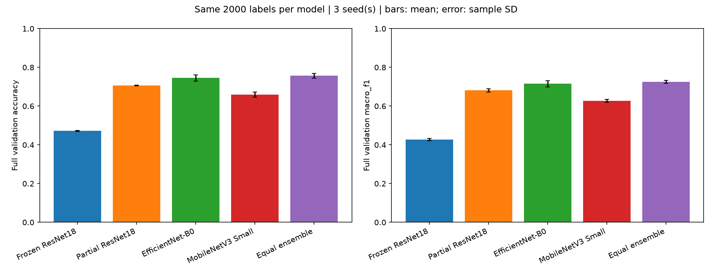
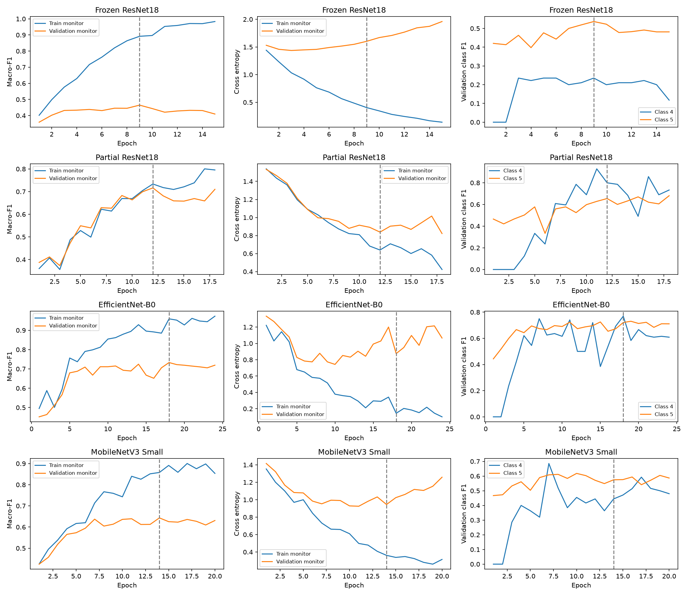

# Label-Efficient Galaxy Morphology Classification: Active Learning, Representation Adaptation, and Rare-Class Recognition

## Abstract

This project investigates whether combining prediction uncertainty with sample diversity can reduce the annotation requirements of galaxy morphology classification while preserving recognition of rare classes. Using Galaxy10 DECaLS, we first construct an audited dataset and fixed evaluation split, then establish an active learning baseline using frozen ImageNet features. Initial experiments reveal limited overall performance and trade-offs between rare-class improvement and other morphology categories. These findings motivate a second stage focused on the reliability of the underlying image classifier.

Following conservative cleaning, 17,615 images are retained from the original 17,736-image dataset. A matched-budget comparison using 2,000 randomly selected training images and three seeds identifies EfficientNet-B0 as the strongest individual model, achieving **74.55% mean validation accuracy** and **0.7151 ± 0.0165 macro-F1**. A fixed three-model ensemble achieves **75.66% accuracy** and **0.7255 ± 0.0070 macro-F1**. EfficientNet recognizes 30–31 of the 50 rare-class validation images across seeds.

The current findings support the feasibility of the fine-tuning approach and provide a stronger foundation for subsequent acquisition experiments. They do not yet establish annotation savings from active learning. The remaining research task is to compare acquisition strategies using the selected CNN under matched labeling budgets and training protocols.

## 1. Introduction

Galaxy morphology classification provides a setting in which machine learning performance must be considered alongside annotation requirements and class-specific reliability. The task involves assigning galaxy images to categories that describe properties such as smoothness, spiral structure, viewing orientation, and signs of disturbance or merging.

A model can achieve a reasonable overall accuracy while still failing on an infrequent morphology. This is especially relevant when the training distribution is imbalanced: errors on a rare category contribute relatively little to frequency-weighted accuracy, even when that category is a central scientific interest. An annotation strategy that improves aggregate performance may therefore provide limited benefit to rare-class recognition.

Active learning addresses the choice of which images should be labeled next. Rather than selecting every new training example uniformly at random, a model can prioritize images that appear uncertain, poorly represented, or otherwise informative. However, useful acquisition depends on the underlying classifier and its representation. If the representation does not distinguish the relevant morphology, uncertainty and feature-space coverage may fail to identify the examples that would improve the task.

This project consequently examines two connected questions. The first concerns acquisition: can uncertainty and diversity improve the use of a limited labeling budget? The second concerns the model supporting acquisition: can a classifier learn sufficiently informative and repeatable morphology predictions for such a comparison to be meaningful?

The completed experiments address data preparation, an initial frozen-feature acquisition baseline, and the selection of a stronger image-training scheme. The final active learning comparison with the selected fine-tuned model remains the next stage.

## 2. Research Question and Study Objectives

The primary research question is:

> Can active learning that combines predictive uncertainty and sample diversity reduce the number of labeled galaxy images needed to reach a target classification performance while preserving recognition of rare morphology classes?

The study evaluates this question through three objectives.

**Overall classification performance.** Acquisition strategies should be compared at the same training-label budgets using macro-F1 learning curves, with accuracy reported as a complementary measure.

**Rare-class preservation.** Improvements in overall performance should be examined alongside precision, recall, and F1 for the prespecified rare category: class 4, cigar-shaped smooth galaxies.

**Repeatability and fair comparison.** Strategies should share the same initial labeled set within a seed, operate on the same training pool, and use consistent model-training and evaluation rules.

The working hypothesis is that uncertainty and diversity provide complementary information. Uncertainty can identify images near the current model’s decision boundaries, while diversity can reduce redundancy within a query batch and improve coverage of the available feature space. Their combination may therefore provide a more useful batch than either criterion alone.

This hypothesis is not assumed to hold. Uncertainty can emphasize ambiguous examples, and diversity can emphasize visual differences that are not useful for the classification target. A hybrid strategy may also improve one category at the expense of another. These possibilities are part of the evaluation.

## 3. Dataset and Data Curation

### 3.1 Galaxy10 DECaLS

The project uses [Galaxy10 DECaLS](https://astronn.readthedocs.io/en/latest/galaxy10.html), containing **17,736 color images** with dimensions **256 × 256 × 3** across ten morphology classes.

| Class | Morphology | Original count |
|---|---|---:|
| 0 | Disturbed galaxies | 1,081 |
| 1 | Merging galaxies | 1,853 |
| 2 | Round smooth galaxies | 2,645 |
| 3 | In-between round smooth galaxies | 2,027 |
| 4 | Cigar-shaped smooth galaxies | 334 |
| 5 | Barred spiral galaxies | 2,043 |
| 6 | Unbarred tight spiral galaxies | 1,829 |
| 7 | Unbarred loose spiral galaxies | 2,628 |
| 8 | Edge-on galaxies without bulge | 1,423 |
| 9 | Edge-on galaxies with bulge | 1,873 |

The dataset combines imaging from the DESI Legacy Imaging Surveys with morphology labels derived from Galaxy Zoo classifications.

The HDF5 includes images, class labels, and astronomical metadata. The current classifiers use the images as predictors and the morphology labels as targets. Metadata such as redshift and sky coordinates is not included as a model predictor.

### 3.2 Why Cleaning Precedes Model Comparison

Duplicate or linked observations can compromise both classification evaluation and annotation-budget accounting. If nearly identical records appear in training and validation, evaluation may reward recognition of repeated observations. If repeated records are queried separately, the apparent labeling budget may also overstate the amount of distinct information acquired.

Conflicting labels within a linked group create a different problem: the same or conservatively associated image content may be assigned incompatible targets. Automatically selecting one label would introduce an additional, unsupported labeling decision.

The preparation procedure therefore prioritizes traceability and conservative handling of ambiguity.

### 3.3 Cleaning Procedure

The raw HDF5 is opened read-only. The preparation process:

1. Checks image structure, label alignment, and the expected ten-class label range.
2. Scans images for nonfinite pixel values.
3. Identifies byte-identical images using image hashes.
4. Links observations with exactly equal finite RA/Dec coordinate pairs.
5. Joins these relationships transitively.
6. Excludes entire linked groups containing conflicting labels.
7. Retains one valid representative from a consistent linked group when applicable.
8. Preserves original HDF5 row indices in all saved audit records.

Missing metadata alone does not exclude an otherwise valid image. In particular, nonfinite redshift values are recorded, but redshift is not required by the current image classifier.

The completed preparation excludes **121 images associated with conflicting labels in linked groups**, retaining **17,615 images**.

This procedure addresses known exact matches and conservative coordinate links. It does not establish that every near-duplicate, neighboring object, or related astronomical observation has been identified.

### 3.4 Fixed Partition

The retained dataset is divided into a training pool, validation set, and test set using a fixed, approximately 70/15/15 class-stratified allocation.

| Partition | Images | Purpose |
|---|---:|---|
| Training pool | 12,330 | Source of training and acquisition candidates |
| Validation | 2,643 | Early stopping and model development |
| Test | 2,642 | Separate evaluation partition |

Class 4 contains 333 retained images, including 50 validation images. All ten classes remain in every evaluation.

The fixed `splits.csv` fingerprint is:

```text
39c4d6ecc7c0d823bafece1a0858b908d495a86e5dff3692c981808c705f6703
```

Keeping this split fixed allows subsequent model comparisons to share the same evaluation population.

## 4. Methodology

### 4.1 Pool-Based Active Learning Formulation

Let \(L_t\) denote the labeled training set at acquisition round \(t\), and let \(U_t\) denote the remaining unlabeled training pool.

A classifier is trained using the labels in \(L_t\). An acquisition rule selects a batch \(Q_t \subseteq U_t\), after which the selected labels are revealed:

\[
L_{t+1}=L_t\cup Q_t,
\qquad
U_{t+1}=U_t\setminus Q_t.
\]

The cumulative training-label budget includes the initial labeled set and all subsequent queries.

Because this is a benchmark simulation, ground-truth labels exist in the dataset files. Acquisition routines do not receive those labels as selection inputs. Labels enter model training only after the corresponding examples have been selected and revealed.

Unlabeled images may be encoded or assigned predictive probabilities without revealing their target classes.

### 4.2 Acquisition Strategies in the Initial Baseline

The completed frozen-feature baseline compares four strategies.

**Random sampling.** Images are selected uniformly without replacement from the remaining pool. This establishes the reference performance achievable without model-directed acquisition.

**Uncertainty sampling.** For each available image, the classifier predicts a distribution over ten classes. Uncertainty is measured using predictive entropy:

\[
H(x)=-\sum_{c=1}^{10}p(c\mid x)\log p(c\mid x).
\]

The highest-entropy images are selected. This prioritizes examples for which the current classifier distributes probability across multiple alternatives.

**Diversity sampling.** Image features are L2-normalized, and greedy farthest-first selection expands coverage relative to the labeled set. At each selection step, the next image maximizes its distance to the nearest existing center:

\[
x^{*}
=
\arg\max_{x\in U_t}
\min_{z\in L_t\cup Q_t}
\|\tilde f(x)-\tilde f(z)\|_2^2.
\]

The selected query batch is incorporated into the center set as the batch is constructed, reducing redundancy among new selections.

**Hybrid sampling.** Images are first ranked by predictive entropy. The highest-entropy candidates form a shortlist, and farthest-first selection chooses a diverse batch from that shortlist. The historical implementation uses a shortlist of up to five times the query-batch size.

The shortlist multiplier is a fixed design choice, not evidence of an optimal combination. The strategy combines existing acquisition ideas rather than introducing a new acquisition algorithm.

### 4.3 Initial Frozen-Feature Model

The first active learning experiment uses an ImageNet-pretrained ResNet18 with frozen convolutional parameters.

Images are resized to 224 × 224 using the full field of view. The final classification layer is removed, producing 512-dimensional features that can be cached and reused across rounds.

At each annotation budget, a fresh MLP classifier is trained:

\[
512 \rightarrow 128
\rightarrow \operatorname{ReLU}
\rightarrow \operatorname{Dropout}(0.1)
\rightarrow 10.
\]

Feature standardization is fitted only on the currently labeled training examples.

This design makes repeated acquisition experiments computationally practical and keeps the representation fixed while comparing selection rules. Its limitation is that the encoder cannot adapt to the target morphology task.

The historical acquisition protocol uses 200 initial labels, query batches of 200, and a maximum of 2,000 labels. Strategies share the initial labeled set within each seed.

### 4.4 Model Diagnostics and Representation Adaptation

Limited baseline performance does not identify its cause on its own. Potential explanations include insufficient training labels, limited target-domain representation, classifier optimization, and difficult or ambiguous morphology boundaries.

The diagnostic stage therefore compares training and validation performance and examines alternative classifiers on the same frozen features.

A frozen-feature MLP trained with all 12,330 training-pool labels achieves a mean validation macro-F1 of **0.5545**. A tuned linear classifier achieves **0.5426** on the same validation set. These results motivate investigating the representation and image-training scheme rather than relying only on additional changes to the classifier head.

They do not prove that the frozen encoder is the sole limitation. The subsequent image experiments change several aspects of training and should be interpreted as comparisons of complete training schemes.

### 4.5 CNN Fine-Tuning Design

The current comparison includes:

| Model | Parameters updated |
|---|---|
| Frozen ResNet18 | Classifier head only |
| Partial ResNet18 | `layer3`, `layer4`, and classifier head |
| EfficientNet-B0 | Backbone and classifier head |
| MobileNetV3 Small | Backbone and classifier head |

All models use official ImageNet initialization and a classifier head with 128 hidden units, ReLU, dropout 0.1, and ten output classes.

Partial fine-tuning provides an intermediate design: later layers adapt to morphology while earlier convolutional blocks remain fixed. EfficientNet and MobileNet provide alternative representations and computational profiles.

The comparison is intended to select a practical training scheme for subsequent acquisition experiments. It is not an architecture-only ablation with every training component held identical.

### 4.6 Preprocessing and Augmentation

The current image comparison resizes the full image to **128 × 128**. Full-frame resizing avoids deliberately cropping away the outer image region, while the reduced resolution makes CPU-based experimentation more practical.

Fine-tuned models use independent quarter-turn rotations and horizontal/vertical flips during training. These transformations treat image orientation as a nuisance factor and encourage the classifier to use morphology rather than a preferred orientation.

Validation images are not augmented. Random crops and color perturbations are not used in the current comparison.

The resolution remains a limitation: resizing can suppress small structures, including subtle spiral or bar features. The experiments do not isolate the effect of resolution.

### 4.7 Optimization and Checkpoint Selection

The current training protocol uses AdamW with:

- Classifier-head learning rate: 0.001.
- Pretrained-backbone learning rate: 0.0001.
- Weight decay: 0.0001.
- Batch size: 32.
- Gradient norm limit: 5.
- Two classifier-head warm-up epochs.
- Maximum 30 epochs and minimum training length of 8 epochs.

Pretrained BatchNorm running statistics remain fixed. Initial-encoder feature-normalization statistics are fitted using the labeled training subset and then held fixed during training.

Early stopping monitors macro-F1 on a stratified subset of 800 validation images, with patience 6 and a minimum improvement of 0.0001. The highest observed monitor-F1 checkpoint is restored; cross-entropy breaks ties.

The final training and full-validation metrics are calculated using that restored model.

## 5. Experimental Design

### 5.1 Matched Training-Label Budget

The principal CNN comparison uses **2,000 uniformly selected training images per seed**.

Within a seed, every model receives exactly the same training images. The subset is not constructed by examining labels to ensure rare-class coverage. This preserves the limited-label interpretation of the experiment.

Seeds 42, 43, and 44 vary the training subset, model randomness, and validation-monitor selection. They share the same complete validation partition.

The resulting variation therefore describes repeatability of the overall development procedure. It does not isolate initialization variance or provide three independent evaluation datasets.

### 5.2 Evaluation Metrics

Accuracy is reported for interpretability, but macro-F1 is the main classification measure because each class contributes equally:

\[
F1_c=\frac{2P_cR_c}{P_c+R_c},
\qquad
\operatorname{MacroF1}
=
\frac{1}{10}\sum_{c=1}^{10}F1_c.
\]

Precision and recall remain important for class 4. High recall obtained by predicting the rare class too frequently would not provide the same evidence as balanced precision and recall.

The analysis consequently considers:

- Overall accuracy and macro-F1.
- Class 4 precision, recall, and F1.
- Class 5 performance and all-class outcomes.
- Training–validation gaps.
- Best checkpoint and stopping behavior.
- Variation across seeds.
- Computational requirements.

### 5.3 Ensemble Reference

The ensemble averages class probabilities from partial ResNet18, EfficientNet, and MobileNet:

\[
p_{\mathrm{ensemble}}(c\mid x)
=
\frac{
p_{\mathrm{ResNet}}(c\mid x)
+
p_{\mathrm{EfficientNet}}(c\mid x)
+
p_{\mathrm{MobileNet}}(c\mid x)
}{3}.
\]

The weights are fixed and equal. No additional training labels are used, but three models must be trained and evaluated.

The ensemble provides a performance reference and an indication of whether the candidate models make complementary errors. It is not an independent replication.

## 6. Results

### 6.1 Initial Acquisition Results Reveal a Class-Level Trade-Off

In the historical frozen-feature experiment, hybrid sampling achieves a mean validation macro-F1 of **0.4883**, compared with **0.4802** for random sampling at 2,000 labels.

The class-level comparison is less uniform:

| Validation metric | Random | Hybrid |
|---|---:|---:|
| Overall macro-F1 | 0.4802 | 0.4883 |
| Class 4 F1 | 0.2642 | 0.3691 |
| Class 5 F1 | 0.4778 | 0.3869 |

The hybrid result is consistent with improved recognition of the rare category in this experiment, but that improvement is accompanied by reduced class 5 performance.

This demonstrates why an acquisition strategy should not be evaluated through one aggregate score or one selected category alone. The predeclared validation-performance targets were not established within the historical query budget, so this experiment did not demonstrate the intended target-based annotation savings.

### 6.2 Small-Budget Image Pilot

A subsequent pilot uses 512 training images and a maximum of six epochs. EfficientNet reaches **0.4822 validation macro-F1**, while the frozen ResNet18 baseline reaches **0.3617**.

However, the training subset contains only six class 4 images. EfficientNet recognizes only one of the 50 class 4 validation images, and several other candidates fail to recognize the category.

The pilot therefore establishes that learnable image representations are promising while also showing that overall gains do not automatically protect a rare class.

The larger experiment increases the label budget, training allowance, and validation-monitor size together. Its improvement should not be interpreted as an isolated causal effect of additional labels.

### 6.3 Three-Seed CNN Comparison

The main image-model results use the complete 2,643-image validation set.

| Model | Mean accuracy | Macro-F1, mean ± SD | Class 4 F1 | Class 4 recall | Class 5 F1 |
|---|---:|---:|---:|---:|---:|
| Frozen ResNet18 | 47.21% | 0.4265 ± 0.0057 | 0.1799 | 0.1400 | 0.4174 |
| Partial ResNet18 | 70.66% | 0.6812 ± 0.0077 | 0.6414 | 0.6133 | 0.6339 |
| **EfficientNet-B0** | **74.55%** | **0.7151 ± 0.0165** | **0.6396** | **0.6067** | **0.7037** |
| MobileNetV3 Small | 65.94% | 0.6272 ± 0.0076 | 0.5306 | 0.5400 | 0.5541 |
| **Equal-probability ensemble** | **75.66%** | **0.7255 ± 0.0070** | **0.6693** | **0.6400** | **0.7032** |

EfficientNet is the strongest individual model in every seed. Its mean macro-F1 exceeds the current frozen ResNet baseline by approximately **0.2886**.

This supports the selection of an adapted image-training scheme. Because augmentation and trainable parameters differ between schemes, the result does not isolate the contribution of backbone adaptation alone.



### 6.4 Repeatability and Rare-Class Recognition

| Seed | EfficientNet accuracy | EfficientNet macro-F1 | Class 4 correct / 50 | Ensemble macro-F1 |
|---|---:|---:|---:|---:|
| 42 | 76.28% | 0.7328 | 30 / 50 | 0.7263 |
| 43 | 74.23% | 0.7126 | 30 / 50 | 0.7320 |
| 44 | 73.14% | 0.7000 | 31 / 50 | 0.7181 |

EfficientNet’s class 4 recall is 60%, 60%, and 62%, despite the corresponding training subsets containing 36, 44, and 39 examples of that class. This provides encouraging evidence that the rare-class result is repeatable across the tested development runs.

EfficientNet does not dominate every metric. Partial ResNet’s average class 4 F1 is **0.6414**, close to EfficientNet’s **0.6396**, despite its lower overall macro-F1. The choice of EfficientNet is therefore based on its stronger overall performance rather than a claim that it is uniformly superior for rare categories.

### 6.5 Ensemble Benefits Are Modest and Not Uniform

The ensemble improves average macro-F1 from **0.7151 to 0.7255** and reduces overall seed standard deviation from **0.0165 to 0.0070**.

Its average class 4 F1 also improves, but the benefit varies across seeds. In seed 42, the ensemble has lower overall and class 4 F1 than EfficientNet alone.

The ensemble is consequently useful as a reference, while its additional computation and nonuniform class-level benefit limit the case for using it as the default acquisition model.

### 6.6 Remaining Errors and Overfitting

The strongest model still performs unevenly across morphology categories.

EfficientNet’s average validation F1 is approximately:

| Class | Average F1 |
|---|---:|
| Disturbed galaxies | 0.3104 |
| Round smooth galaxies | 0.9036 |
| Cigar-shaped smooth galaxies | 0.6396 |
| Unbarred loose spiral galaxies | 0.5876 |
| Edge-on galaxies without bulge | 0.8663 |

Class 0 remains substantially weaker than several common smooth and edge-on categories. This suggests that the remaining difficulty cannot be characterized solely as a rare-class frequency problem.

EfficientNet’s mean training-minus-validation macro-F1 gap is approximately **0.2144**. Its selected epochs are 18, 20, and 11, with training stopping at epochs 24, 26, and 17.

The curves show continued training improvement after validation performance becomes unstable or plateaus. Early stopping therefore remains useful, but the retained models still exhibit a meaningful generalization gap.



Additional curves: [seed 43](results/image_models_2000/figures/training_curves_seed_43.png) and [seed 44](results/image_models_2000/figures/training_curves_seed_44.png).

## 7. Discussion

### 7.1 Model Quality Conditions the Acquisition Question

The initial frozen-feature experiment and later CNN comparison address different parts of the study.

The acquisition baseline examines how labels are selected under a fixed representation. The image comparison examines whether a more effective training scheme can support the next acquisition experiment.

These stages should not be collapsed into a claim that fine-tuning itself demonstrates active learning benefit. Stronger randomly sampled training results establish a more credible baseline against which acquisition strategies must compete.

### 7.2 Aggregate Improvement Does Not Guarantee Class Preservation

The historical hybrid result improves class 4 while reducing class 5 performance. The CNN comparison also shows that the best overall single model is not uniquely best for class 4.

These findings support the original decision to evaluate rare-class preservation explicitly. A useful acquisition policy must be assessed through the joint behavior of overall and class-specific metrics, rather than selecting whichever individual score is favorable.

### 7.3 Classification and Uncertainty Quality Require Separate Evaluation

The planned uncertainty strategy depends on predicted probabilities, not only the final predicted class.

A model with strong macro-F1 may still assign unreliable confidence to some errors. The observed validation-loss behavior motivates checking probability quality before interpreting entropy as a reliable measure of acquisition value.

The current metrics do not establish whether uncertainty-based selection will outperform random sampling. That remains an experimental question.

### 7.4 Computation Is Part of the Design

EfficientNet offers the strongest individual classification results, while MobileNet is substantially faster in the recorded CPU runs.

Repeated acquisition rounds multiply training and pool-evaluation costs. The selected model must therefore be evaluated in terms of both annotation efficiency and computational feasibility.

A small acquisition pilot is appropriate before expanding to every strategy and seed. The full comparison should retain consistent rules rather than allowing additional computation only for favored strategies.

## 8. Limitations

**Development-validation evaluation.** The current validation partition informs early stopping and model selection. Reported CNN scores are development results rather than independent final confirmation.

**Evaluation history.** The earlier frozen-feature experiment evaluated the test partition. Later CNN development did not evaluate it, but the project must not describe it as never inspected during the entire research process.

**Limited repeated runs.** Three seeds support descriptive repeatability analysis. They do not establish formal statistical significance, non-inferiority, or performance on independent datasets.

**Small rare-class evaluation set.** Class 4 has 50 validation images. Each additional correct prediction changes recall by two percentage points, so small differences require caution.

**Combined training changes.** Comparisons across development stages change multiple factors, including label budget, training duration, resolution, and monitor settings. They do not isolate each factor’s effect.

**Residual data relationships.** Exact hashes and coordinate linkage do not detect every possible near-duplicate or related object. The split is not a dedicated cross-survey or spatial generalization evaluation.

**Additional labeled resources.** The reported training-label budget excludes the fixed validation and test labels. ImageNet pretraining is also an external shared resource.

**Remaining acquisition experiment.** Fine-tuned EfficientNet has not yet completed the planned active learning comparison. Annotation savings cannot be inferred from its current classification scores.

## 9. Next Experimental Stage

The next stage will hold the selected EfficientNet training scheme fixed and vary acquisition strategy.

A proposed budget grid is **500, 1,000, 1,500, and 2,000 training labels**. Within each seed, random, uncertainty, diversity, and hybrid strategies will share the same initial labeled subset and evaluation data.

The evaluation will examine:

1. Macro-F1 learning curves and normalized learning-curve area.
2. Class 4 precision, recall, and F1 across budgets.
3. Performance across all ten morphology classes.
4. The number and distribution of queried labels.
5. Acquisition and training computation.
6. Labels required to satisfy a prespecified overall-performance target and rare-class requirement.

For a target performance \(\tau\), label savings can be defined using the observed budgets required by a strategy and the random baseline:

\[
\operatorname{Savings}(\tau)
=
1-
\frac{B_{\mathrm{strategy}}(\tau)}
{B_{\mathrm{random}}(\tau)}.
\]

This comparison is meaningful only when the relevant target and rare-class requirement are reached under the same evaluation rules. Unreached targets will be reported as unreached rather than extrapolated.

The completed frozen-feature acquisition experiment is retained as an exploratory baseline. It will not be presented as the result of fine-tuned EfficientNet acquisition.

## 10. Conclusion

The completed experiments establish a reproducible data preparation procedure and identify a practical image-training scheme for limited-label galaxy morphology classification.

Across three seeds, EfficientNet-B0 provides repeatable overall and rare-class validation performance using 2,000 randomly selected training images. The ensemble offers a modest average improvement at greater computational cost. Persistent class-level weaknesses and generalization gaps remain.

These findings support proceeding with the active learning study. The main research claim—whether uncertainty and diversity reduce labeling requirements while preserving rare-class recognition—will be determined by the next matched-budget acquisition comparison.

## Code and Result Navigation

The current CNN comparison is launched with:

```powershell
.\.venv\Scripts\python.exe .\run_image_2000.py --seeds 42 43 44
```

Operational instructions are maintained separately in:

- [Current image-model experiment](README_IMAGE_2000.md)
- [Initial active learning baseline](README_ACTIVE_LEARNING.md)
- [Model diagnostics](README_DIAGNOSTICS.md)
- [Classifier-head comparisons](README_HEAD_ABLATION.md)

Published current results:

- [Full report](results/image_models_2000/image_2000_report.md)
- [Seed-level metrics](results/image_models_2000/metrics_by_seed.csv)
- [Mean and standard deviation](results/image_models_2000/metrics_mean_std.csv)
- [Per-class metrics](results/image_models_2000/per_class_metrics.csv)
- [Class supports](results/image_models_2000/class_counts.csv)

## Acknowledgments

The project uses [Galaxy10 DECaLS](https://astronn.readthedocs.io/en/latest/galaxy10.html), with source imaging from the [DESI Legacy Imaging Surveys](https://www.legacysurvey.org/) and morphology labels derived from [Galaxy Zoo](https://www.galaxyzoo.org/).

Model implementations and official pretrained weights are provided through [PyTorch](https://pytorch.org/) and [torchvision](https://docs.pytorch.org/vision/stable/). Dataset construction code is available in the [Galaxy10 repository](https://github.com/henrysky/Galaxy10).

This project reports an empirical application study and reproducible experimental framework. It does not claim a new CNN architecture, a previously unknown acquisition algorithm, or a state-of-the-art benchmark result.