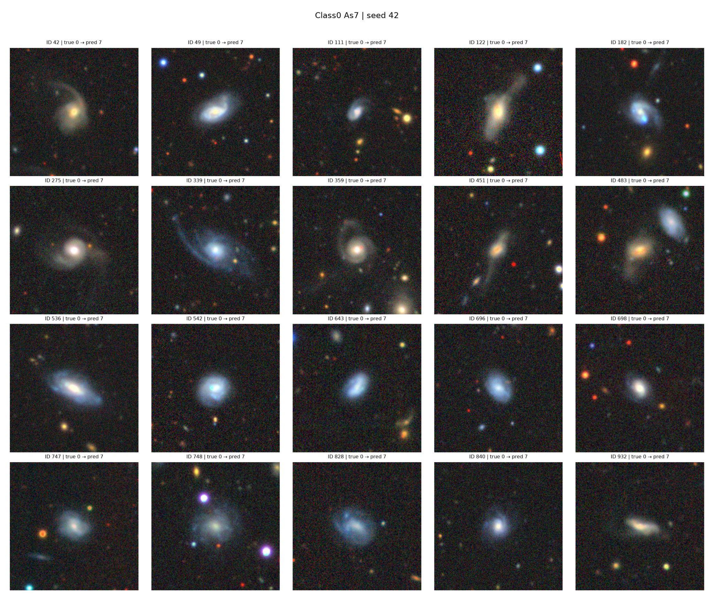
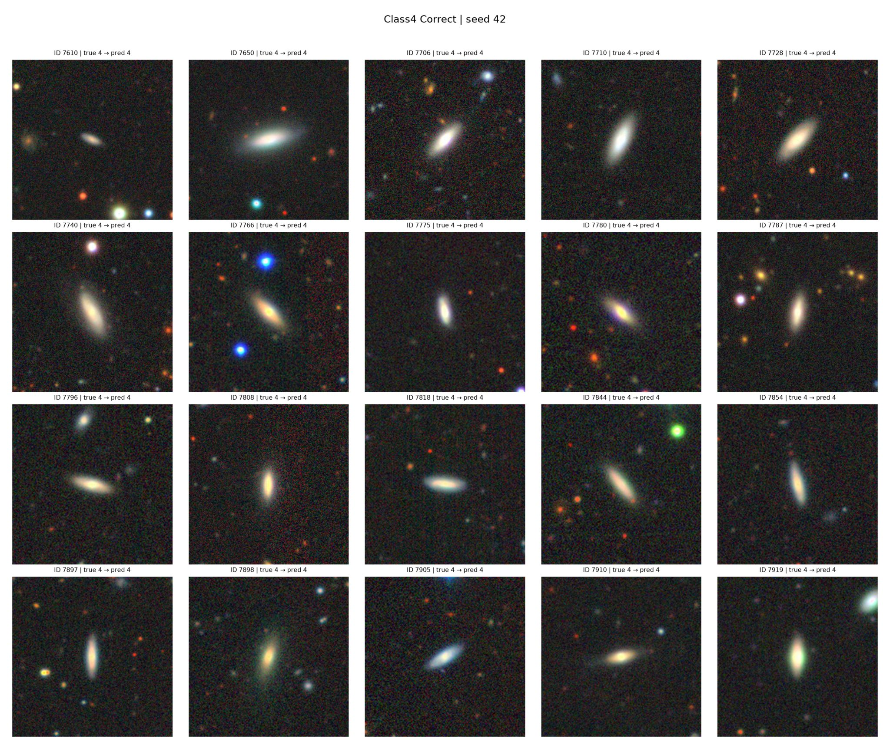

# Galaxy Morphology Classification with Limited Labeled Data

### A comparative study of transfer learning, CNN fine-tuning, and ensemble learning on Galaxy10 DECaLS


## Abstract

This study investigates galaxy morphology classification with a fixed budget of 2,000 labeled training images using Galaxy10 DECaLS. We compare frozen feature extraction, partial ResNet18 fine-tuning, and full fine-tuning of MobileNetV3-Small and EfficientNet-B0, followed by an equal-weight ensemble of the three adapted networks. Across three seeds, fine-tuning improves substantially over frozen features, and the ensemble achieves 75.41% ± 1.18% held-out accuracy and 0.7238 ± 0.0078 macro-F1, exceeding the best single model by 1.50 percentage points and 0.0186 macro-F1. Class-level evaluation indicates that morphology-dependent visual ambiguity remains a source of error. These results support fine-tuning and complementary model aggregation as effective strategies within the evaluated labeling budget.

## 1. Research motivation

Galaxy morphology provides clues about the structure and evolution of galaxies. The Galaxy Zoo project established the value of large-scale volunteer morphology annotations, while Galaxy Zoo DECaLS demonstrated that deeper imaging reveals features such as weak bars, spiral arms, and tidal structure that are difficult to see in shallower surveys¹,². Yet producing reliable labels remains resource-intensive, and morphological categories can be difficult to distinguish in small image cutouts. Prior work on feature transfer shows that early CNN representations are often broadly reusable, whereas higher-level features become increasingly task-specific³. We therefore examine how different forms of transfer learning and model combination perform when the available labeled training subset is held fixed. The experiment compares methods at one label budget; it does not estimate the minimum number of labels required to reach a target accuracy.

The research objectives are to quantify the benefit of adapting pretrained features rather than freezing them, compare CNN architectures under the same labeled-image budget, and determine whether combining their predictions improves held-out performance. The class-level analysis then examines which morphological categories remain difficult after model aggregation.

## 2. Dataset and experimental setup

| Item | Experimental setting |
|---|---|
| Dataset | Galaxy10 DECaLS⁴; 10 morphological classes |
| Cleaned images | 17,615 |
| Training pool | 12,330 images |
| Validation set | 2,643 images |
| Held-out test set | 2,642 images |
| Labeled training budget | 2,000 images per seed (16.2% of training pool) |
| Random seeds | 42, 43, 44 |
| Input resolution | 128 × 128 RGB |
| Primary evaluation metric | Macro-F1; accuracy reported alongside it |

All models within a given seed use the same labeled subset. The validation data guide checkpoint selection, while the test set is reserved for final evaluation. The preprocessing pipeline resizes images, applies ImageNet normalization, and uses rotation/flip augmentation for the fine-tuned models. Results are reported as mean ± standard deviation across three seeds.

Macro-F1 is particularly useful here because an accurate model should recognize all ten galaxy classes, not simply favor the more common ones.

## 3. Methodology

The central design decision is to compare different ways of adapting pretrained visual representations, then test whether their errors are complementary.

### 3.1 Frozen ResNet18: feature extraction baseline

The first approach uses a pretrained ResNet18⁵ as a fixed visual feature extractor. Its convolutional backbone is frozen, and only a lightweight classification head is trained to map extracted features to the ten galaxy classes.

Frozen features are computationally inexpensive and provide a useful baseline for assessing whether general-purpose ImageNet representations are sufficient for astronomical morphology. However, the backbone cannot adapt its feature detectors to galaxy-specific structures.

### 3.2 Partially fine-tuned ResNet18: adapting higher-level features

The second approach retains the ResNet18 architecture but unfreezes later backbone layers along with the classification head. Earlier layers preserve broadly useful low-level patterns, while higher-level layers adapt to the galaxy images. This design is motivated by evidence that transferability varies with network depth and source-target task similarity³.

Unlike frozen feature extraction, the representation itself can improve during training. Partial fine-tuning balances domain adaptation against the risk and computational cost of updating the entire network when labels are limited.

### 3.3 MobileNetV3-Small: a lightweight end-to-end CNN

MobileNetV3-Small, introduced by Howard et al.⁶, is designed for computational efficiency using hardware-aware architecture search and lightweight convolutional building blocks. In this experiment, the pretrained backbone and the new ten-class head are fine-tuned on the labeled galaxy subset.

It tests whether a compact network can learn useful astronomical features with limited data, offering an efficiency-oriented alternative to larger CNNs. Its lower capacity may also limit its ability to distinguish subtle morphological differences.

### 3.4 EfficientNet-B0: an accuracy-oriented fine-tuned CNN

EfficientNet-B0, introduced by Tan and Le⁷, belongs to a model family built around jointly balancing network depth, width, and image resolution. Its pretrained backbone is fine-tuned end-to-end with a ten-class output head.

EfficientNet provides a stronger single-model candidate, allowing us to test whether a more expressive pretrained architecture can extract better galaxy-specific features under exactly the same labeling constraint.

### 3.5 Summary of model differences

| Approach | What is trained? | Main purpose |
|---|---|---|
| Frozen ResNet18 | Classification head only | Establish a low-cost transfer-learning baseline |
| Partial ResNet18 | Later backbone layers + head | Test the value of domain-specific feature adaptation |
| MobileNetV3-Small | Backbone + head | Evaluate a compact, efficient CNN |
| EfficientNet-B0 | Backbone + head | Evaluate a stronger individual CNN architecture |
| Three-model ensemble | No extra model fitting | Combine complementary predictions from the three fine-tuned CNNs |

The comparison is designed to distinguish representation adaptation, architecture choice, and ensemble effects. All four individual CNN configurations are evaluated under the same labeled-image budget.

### 3.6 Equal-weight probability ensemble

The final system combines the partially fine-tuned ResNet18, MobileNetV3-Small, and EfficientNet-B0. Each model outputs ten class probabilities. Instead of selecting a single model or taking a majority vote, we average the predicted probabilities and choose the class with the largest average probability.

For class `c` and image `x`, the ensemble computes:

$$
\bar{p}(c\mid x)=\frac{p_{\mathrm{ResNet}}(c\mid x)+p_{\mathrm{MobileNet}}(c\mid x)+p_{\mathrm{EfficientNet}}(c\mid x)}{3}
$$

The predicted class is:

$$
\hat{y}(x)=\operatorname*{arg\,max}_{c}\;\bar{p}(c\mid x)
$$

Ensemble learning combines predictions from multiple classifiers and can benefit from differences in their errors, as discussed by Dietterich⁸. Models with different architectures can make different mistakes. A strong prediction from one model may compensate for a weaker or incorrect prediction from another. Averaging probabilities also retains information about each model's confidence that a simple majority vote discards.

The ensemble does not use 6,000 different labeled images. All three members are trained on the same 2,000-image subset within each seed. The weights are fixed at one-third each, with no fitting on the test set. The ensemble increases compute cost, but not the number of distinct labels required.

## 4. Experimental results

### 4.1 Held-out test performance

The table reports mean ± sample standard deviation across seeds 42, 43, and 44, evaluated on the same 2,642 held-out test images per seed.

| Model | Test accuracy | Test macro-F1 |
|---|---:|---:|
| Frozen ResNet18 | 47.59% ± 0.57% | 0.4280 ± 0.0127 |
| Partial ResNet18 | 70.73% ± 0.71% | 0.6796 ± 0.0068 |
| MobileNetV3-Small | 65.35% ± 0.94% | 0.6116 ± 0.0023 |
| EfficientNet-B0 | 73.91% ± 1.20% | 0.7052 ± 0.0096 |
| Equal-weight ensemble (3) | 75.41% ± 1.18% | 0.7238 ± 0.0078 |

Fine-tuning substantially outperforms the frozen-feature ResNet18 baseline under this experimental setup. EfficientNet-B0 is the strongest single model, but the ensemble improves upon it by 1.50 percentage points in test accuracy and 0.0186 absolute macro-F1 (approximately 2.6% relative macro-F1 improvement). These improvements are descriptive; no formal significance claim is made.

### 4.2 Results across random seeds

| Seed | Ensemble test accuracy | Ensemble test macro-F1 |
|---|---:|---:|
| 42 | 76.31% | 0.7302 |
| 43 | 75.85% | 0.7262 |
| 44 | 74.07% | 0.7150 |
| Mean ± SD | 75.41% ± 1.18% | 0.7238 ± 0.0078 |

The ensemble exceeds EfficientNet-B0 in test accuracy and macro-F1 for each of the three seeds. 

### 4.3 Class-level performance

Per-class metrics below are the mean of each seed's ensemble metrics; `support` is the number of unique test images in that class, not the sum across seeds.

| Class ID | Test support | Precision | Recall | F1 |
|---|---:|---:|---:|---:|
| 0 | 157 | 0.479 | 0.278 | 0.351 |
| 1 | 276 | 0.786 | 0.814 | 0.797 |
| 2 | 395 | 0.863 | 0.904 | 0.883 |
| 3 | 303 | 0.802 | 0.854 | 0.827 |
| 4 | 50 | 0.672 | 0.613 | 0.637 |
| 5 | 306 | 0.815 | 0.687 | 0.745 |
| 6 | 273 | 0.696 | 0.608 | 0.648 |
| 7 | 389 | 0.571 | 0.686 | 0.621 |
| 8 | 213 | 0.839 | 0.890 | 0.864 |
| 9 | 280 | 0.859 | 0.874 | 0.866 |

Performance differs substantially by morphology. The ensemble achieves an F1 of 0.883 on Class 2 but only 0.351 on Class 0. Class 4 attains 0.637 despite having the smallest test support. These differences motivate examination of the images and classification errors rather than relying exclusively on aggregate accuracy.

### 4.4 Class-level effects of ensembling

Comparing per-class F1 against EfficientNet-B0:

| Class | EfficientNet-B0 F1 | Ensemble F1 | Change |
|---|---:|---:|---:|
| 0 | 0.3601 | 0.3510 | −0.0091 |
| 1 | 0.7727 | 0.7966 | +0.0239 |
| 2 | 0.8686 | 0.8826 | +0.0140 |
| 3 | 0.8288 | 0.8267 | −0.0021 |
| 4 | 0.5374 | 0.6368 | +0.0994 |
| 5 | 0.7461 | 0.7451 | −0.0010 |
| 6 | 0.6255 | 0.6477 | +0.0221 |
| 7 | 0.5947 | 0.6210 | +0.0262 |
| 8 | 0.8584 | 0.8640 | +0.0056 |
| 9 | 0.8598 | 0.8662 | +0.0065 |

The largest gain occurs in Class 4, where mean F1 increases by 0.0994 relative to EfficientNet-B0. Improvements are also observed in Classes 1, 6, and 7, although the ensemble does not improve every category. In particular, Class 0 F1 decreases slightly. These differences indicate that the ensemble changes the distribution of errors rather than simply improving every class by a similar amount.

A paired comparison of EfficientNet-B0 and ensemble predictions over the three seeds found 468 cases in which the ensemble corrected an EfficientNet error versus 349 cases in which it introduced an error, for a net gain of 119 correct predictions across seed-image evaluations. Because the same test images are evaluated in three seeds, these counts are not 468 or 349 independent images.

## 5. Error analysis and discussion

### 5.1 Morphological variation and class-specific performance

Class 0 has 157 test examples versus 50 for Class 4, yet its ensemble recall is 0.278 versus 0.613 and its F1 is 0.351 versus 0.637. More evaluation examples do not imply a class is easier to recognize, and evaluation support alone does not measure the number of training examples seen by the model.

Visual inspection of original test images provides a plausible explanation. Class 0 examples exhibit a heterogeneous range of appearances, including compact, diffuse, irregular, and relatively smooth-looking structures. Some resemble images assigned to other classes. By contrast, many correctly classified Class 4 examples share a distinctly elongated, high-aspect-ratio appearance. This visual regularity may provide a more consistent discriminative cue even under a limited labeling budget.

Galaxy10 DECaLS identifies Class 0 as disturbed galaxies and Class 4 as cigar-shaped smooth galaxies⁴. The observed difference is consistent with greater within-class variation and overlap in the disturbed category, although the image grids alone cannot establish which factors cause the performance gap.

### 5.2 Qualitative visual inspection

Visual grids compare correctly classified Class 0 images, Class 0 images misclassified as Classes 7 and 3, and correctly and incorrectly classified Class 4 images. The Class 0 error examples include both compact/smooth and more diffuse appearances; Class 4 correct examples frequently display elongated structure. Class 4 errors also show that elongation alone is not sufficient for reliable recognition.

The figure files are kept in [`results/visual_error_analysis/`](results/visual_error_analysis/) in this repository:

| Visual sample | File |
|---|---|
| Class 0 → Class 7 | [`class0_as7.jpg`](results/visual_error_analysis/class0_as7.jpg) |
| Class 0 correctly classified | [`class0_correct.jpg`](results/visual_error_analysis/class0_correct.jpg) |
| Class 0 → Class 3 | [`class0_as3.jpg`](results/visual_error_analysis/class0_as3.jpg) |
| Class 4 correctly classified | [`class4_correct.jpg`](results/visual_error_analysis/class4_correct.jpg) |
| Class 4 misclassified | [`class4_wrong.jpg`](results/visual_error_analysis/class4_wrong.jpg) |

Representative comparison:





The examples illustrate recurring visual characteristics; quantitative class-level performance is reported separately in Section 4.

## 6. Discussion and conclusion

The results address the study's three research objectives under a common training budget. First, the difference between frozen and partially fine-tuned ResNet18 establishes the importance of adapting pretrained representations to galaxy imagery. Partial fine-tuning raises mean held-out accuracy from 47.59% to 70.73% and macro-F1 from 0.4280 to 0.6796. This is a substantial improvement without increasing the number of labeled training images, indicating that fixed ImageNet features alone do not adequately capture the distinctions needed for this morphology task.

Second, architecture choice matters even when the labeling budget is unchanged. Among the individual networks, EfficientNet-B0 obtains the highest accuracy and macro-F1, outperforming both partially fine-tuned ResNet18 and MobileNetV3-Small. The comparison does not isolate architecture from all other implementation differences, but it demonstrates that the choice of pretrained backbone and adaptation strategy materially affects performance in the evaluated setting. MobileNetV3-Small remains a relevant compact alternative, although computational efficiency was not benchmarked here.

Third, combining the three adapted networks improves upon the strongest individual classifier. The equal-weight ensemble reaches 75.41% accuracy and 0.7238 macro-F1, gains of 1.50 percentage points and 0.0186 respectively over EfficientNet-B0. The improvement is achieved without acquiring additional distinct training labels because the ensemble members share the same 2,000-image subset within each seed. It does require training and running three networks, so the benefit is a performance gain under a fixed annotation budget rather than a reduction in computational cost. The class-level comparison shows that these gains are uneven: Class 4 benefits notably from ensembling, while Class 0 remains difficult.

Taken together, the experiments show that fine-tuning is more consequential than frozen feature extraction for this dataset, that EfficientNet-B0 is the strongest tested individual model, and that probability averaging provides a further, smaller improvement. The qualitative image analysis suggests that morphological distinctiveness and overlap between categories help explain why aggregate accuracy does not translate into uniformly strong class-level recognition. The findings apply to the tested 2,000-label setting and three random seeds; broader claims about label efficiency would require experiments across additional annotation budgets. A useful next step would be to evaluate targeted labeling or class-aware sampling for the morphologies that remain difficult, using the present ensemble as a fixed-budget reference.

## 7. Repository structure and reproducibility

```text
galaxy_al/                  Earlier active-learning experiments
galaxy_image_demo/          CNN pilot experiments
image_budget_runner/        Fixed-budget CNN training pipeline
run_image_2000.py           Three-seed CNN experiment runner
evaluate_final_test.py      Held-out test evaluation from checkpoints
visual_error_analysis.py    Qualitative error inspection
results/
  final_test/               Test report, seed metrics, class metrics, confusion matrices
  visual_error_analysis/    Representative correctly/misclassified galaxy images
README_ACTIVE_LEARNING.md   Earlier active-learning study
README_IMAGE_2000.md        Detailed CNN experiment protocol
```

Run the held-out test evaluation using previously trained checkpoints:

```powershell
.\.venv\Scripts\python.exe evaluate_final_test.py --device cpu --batch-size 32 --threads 4
```

Regenerate visual error grids from saved predictions:

```powershell
.\.venv\Scripts\python.exe visual_error_analysis.py --seed 42 --examples 20
```

These commands evaluate existing checkpoints; they do not retrain models. Source code and public result summaries are provided here, while the raw dataset and large checkpoints are kept outside Git history.

### Earlier active-learning study

This repository began with a separate active-learning investigation, motivated by the general goal of selecting informative examples for labeling⁹, comparing random, uncertainty, diversity, and hybrid sampling using frozen ResNet18 features. Those experiments are documented in [`README_ACTIVE_LEARNING.md`](README_ACTIVE_LEARNING.md). They use a different modeling protocol and should not be interpreted as the source of the 75.41% ensemble result.

## References

The sources below document the dataset, astronomical context, and machine-learning methods used in this study.

1. Willett, K. W., et al. (2013). “Galaxy Zoo 2: Detailed Morphological Classifications for 304,122 Galaxies from the Sloan Digital Sky Survey.” *Monthly Notices of the Royal Astronomical Society*, 435(4), 2835–2860. [Journal article](https://academic.oup.com/mnras/article/435/4/2835/1022913).
2. Walmsley, M., et al. (2022). “Galaxy Zoo DECaLS: Detailed Visual Morphology Measurements from Volunteers and Deep Learning for 314,000 Galaxies.” *Monthly Notices of the Royal Astronomical Society*, 509(3), 3966–3988. [DOI: 10.1093/mnras/stab2093](https://doi.org/10.1093/mnras/stab2093).
3. Yosinski, J., Clune, J., Bengio, Y., & Lipson, H. (2014). “How Transferable Are Features in Deep Neural Networks?” *Advances in Neural Information Processing Systems*, 27. [NeurIPS proceedings](https://proceedings.neurips.cc/paper_files/paper/2014/hash/532a2f85b6977104bc93f8580abbb330-Abstract.html).
4. Leung, H., & Bovy, J. *Galaxy10 DECaLS Dataset*, official dataset repository and documentation. [Official repository](https://github.com/henrysky/Galaxy10) · [Dataset release on Zenodo](https://zenodo.org/records/10845026). *(Dataset resource, not a peer-reviewed research paper.)*
5. He, K., Zhang, X., Ren, S., & Sun, J. (2016). “Deep Residual Learning for Image Recognition.” *Proceedings of the IEEE Conference on Computer Vision and Pattern Recognition*, 770–778. [CVPR open-access paper](https://www.cv-foundation.org/openaccess/content_cvpr_2016/html/He_Deep_Residual_Learning_CVPR_2016_paper.html).
6. Howard, A., et al. (2019). “Searching for MobileNetV3.” *Proceedings of the IEEE/CVF International Conference on Computer Vision*, 1314–1324. [ICCV open-access paper](https://openaccess.thecvf.com/content_ICCV_2019/html/Howard_Searching_for_MobileNetV3_ICCV_2019_paper.html).
7. Tan, M., & Le, Q. (2019). “EfficientNet: Rethinking Model Scaling for Convolutional Neural Networks.” *Proceedings of the 36th International Conference on Machine Learning*, PMLR 97, 6105–6114. [ICML / PMLR proceedings](https://proceedings.mlr.press/v97/tan19a.html).
8. Dietterich, T. G. (2000). “Ensemble Methods in Machine Learning.” *Multiple Classifier Systems*, Lecture Notes in Computer Science, vol. 1857, 1–15. [DOI: 10.1007/3-540-45014-9_1](https://doi.org/10.1007/3-540-45014-9_1).
9. Settles, B. (2009). “Active Learning Literature Survey.” *Computer Sciences Technical Report 1648*, University of Wisconsin–Madison. [University repository](https://minds.wisconsin.edu/handle/1793/60660). *(Technical report.)*

Galaxy10 DECaLS images originate from the DESI Legacy Imaging Surveys, and its class labels derive from Galaxy Zoo²,⁴.
